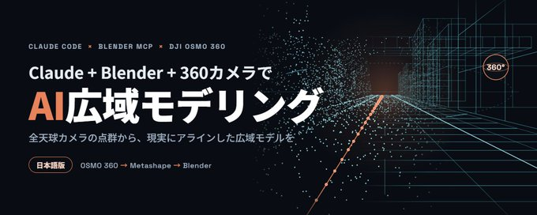
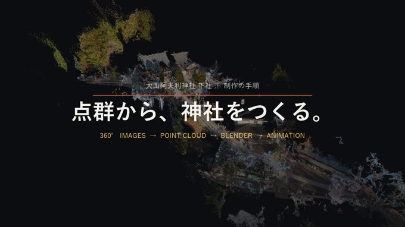

# AI Wide Area Modeling

[English](README.md) | 日本語

撮影データ（写真とカメラ姿勢・点群・3D Gaussian Splatting）を AI エージェントが測りながら、街路・インフラ・寺社・ダムのような**広い範囲の実在シーン**を Blender で軽量な形状モデルに起こすための、[Claude Code](https://claude.com/claude-code) 用のスキルです。

写真をテクスチャとして貼るのではなく、点群の断面で寸法を読み、数値（JSON）と生成スクリプトで形を作り、撮影写真と同じ視点のレンダリングで差分を直していきます。

## できること

- COLMAP 形式のカメラ姿勢・写真・点群から、メートル単位・Z 上のモデル座標系と縮尺を決める
- 点群の平面・断面の画像（1 m 格子付き）で寸法を読む。細い物は写真 2 枚以上から三角測量する
- パラメーター（JSON）と生成スクリプトを分けて、Blender MCP 経由で何度でも作り直す
- 写真｜3DGS｜Blender を同じ視点で並べた比較、点群とモデルの 3D 距離、縮尺の照合
- 仕上げの往復: 撮影写真と同じ姿勢・画角で最終レンダーを描き、差分を原因まで掘って直す
- できたモデルを Unreal Engine に移す（任意）

## 必要な物

| 物 | 必須 | 用途 |
|---|---|---|
| Claude Code（または Agent Skills に対応したエージェント） | 必須 | スキルの実行 |
| Blender と Blender MCP | 必須 | モデリング・レンダリング |
| Python 3 と `numpy`・`Pillow` | 必須 | 解析スクリプト |
| COLMAP 形式の SfM 結果（`cameras` / `images` / `points3D`、写真） | 必須 | カメラ姿勢・写真・点群。他の SfM ソフトの結果も、COLMAP 形式に書き出せば使えます |
| LichtFeld Studio と、その MCP | 任意 | 3D Gaussian Splatting を参照するとき |
| Unreal Engine と、その MCP | 任意 | ゲームエンジンへ移すとき |

## 入れ方

このフォルダを、スキルのフォルダに `ai-wide-area-modeling` という名前で置きます。

```bash
git clone https://github.com/Kotohibi/ai-wide-area-modeling.git ~/.claude/skills/ai-wide-area-modeling
```

Claude Code で、たとえば次のように頼むと使われます。

- 「この COLMAP の結果と点群から、Blender でモデルを起こして」
- 「写真と同じ視点でレンダリングして、ずれを直して」
- 「点群とモデルの縮尺を、上面と側面で比べて」

## 構成

| 場所 | 内容 |
|---|---|
| `SKILL.md` | 手順の本体（エージェントが最初に読む） |
| `references/` | データごとの信頼度、失敗の典型、縮尺の手掛かり、確認のやり方、LichtFeld / Unreal の注意 |
| `scripts/` | 汎用の道具（座標系の設定、点群の書き出しと作図、写真の選択、三角測量、比較シート、Blender / Unreal 用スクリプト） |
| `recipes/` | シーンの種類ごとのレシピと実例の設定値（高架と街路、寺社の門と境内、ダムと洪水吐） |

## 環境変数

レシピのスクリプトは、案件ごとの場所を環境変数で受け取ります。

| 変数 | 意味 |
|---|---|
| `BLENDER_SHARED` | Blender とエージェントの双方から見える共有フォルダ |
| `SFM_DIR` | COLMAP 形式の SfM フォルダ |
| `PROJECT_DIR` | 案件の作業フォルダ |
| `AWAM_SCRIPTS` | このスキルの `scripts/` の場所（スクリプトを `exec` で実行する場合のみ必要） |

## 記事と作例

| 記事 | 作例動画 |
|---|---|
| [](https://x.com/kotohibi_3d/status/2119237951897178563) | [](https://x.com/kotohibi_3d/status/2120888301955719348) |
| **[Claude+Blender+360カメラでAI広域モデリング（日本語版）](https://x.com/kotohibi_3d/status/2119237951897178563)**<br>360°カメラの点群から、現実に合わせた広域モデルを作る手順の解説です（X の記事）。 | **[制作過程の動画（日本語版）](https://x.com/kotohibi_3d/status/2120888301955719348)**<br>点群から Blender でモデルを作り、アニメーションにするまでの過程です（X の投稿）。 |

英語版は [README.md](README.md#article-and-example) にあります。

## 注意

- **縮尺は推定です。** SfM・3DGS の縮尺は不定なので、既知の寸法（階段の蹴上げ、カメラ高、車線幅など）から決めます。結果には根拠と誤差を必ず添えてください。
- `recipes/` は実例の記録で、作れる対象を限定する物ではありません。レシピが無い種類のシーンも、`SKILL.md` の手順だけで作れます。
- `recipes/` のスクリプトは実例の案件で使った物で、案件固有の定数を含みます。流用するときは値を書き換えてください。
- 縮尺の手掛かりの表（`references/knowledge.md`）は日本での目安です。海外の現場では現地の規格で確かめてください。
- このリポジトリに、撮影データ・3D モデル・素材は含まれていません。
- 文書とスクリプト内の説明は、主に日本語です。

## 他の道具・素材について

このスキルは、次の物の使い方に触れていますが、いずれも同梱していません。別途入手し、それぞれの利用規約に従ってください。

- [Blender](https://www.blender.org/)、[LichtFeld Studio](https://github.com/MrNeRF/LichtFeld-Studio)、[COLMAP](https://colmap.github.io/)、Unreal Engine
- [Poly Haven](https://polyhaven.com/) のテクスチャ、Unreal Engine 用の植物アセット
- [国土地理院の標高タイル](https://maps.gsi.go.jp/development/ichiran.html)（利用するときは出典の明記が必要です）

## ライセンス

[MIT License](LICENSE)
