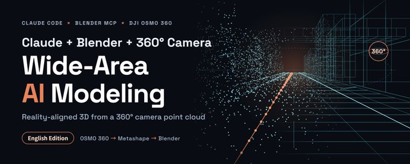
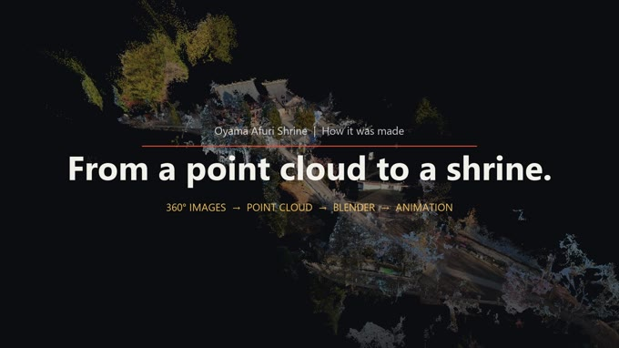

# AI Wide Area Modeling

English | [日本語](README.ja.md)

A skill for [Claude Code](https://claude.com/claude-code) that lets an AI agent turn capture data (photos with camera poses, point clouds, 3D Gaussian Splatting) into lightweight geometric models of **large real-world scenes** in Blender: streets, infrastructure, shrines and temples, dams.

It does not paste photos on as textures. The agent reads dimensions from point-cloud sections, builds the shapes from numbers (JSON) and generator scripts, and corrects the differences by rendering from the same viewpoints as the capture photos.

## What it does

- Sets up a metric, Z-up model frame and a scale from COLMAP-format camera poses, photos and points
- Reads dimensions from plan and section plots of the point cloud (1 m grid); triangulates thin objects from two or more photos
- Keeps parameters (JSON) apart from generator scripts, so the scene can be rebuilt through Blender MCP as often as needed
- Compares photo | 3DGS | Blender from the same viewpoint, measures the 3D distance between cloud and model, and checks the scale
- Finishing loop: renders the final look with the photo's pose and lens, traces each difference to its cause and fixes it
- Ports the finished model to Unreal Engine (optional)
- Publishes it as a Three.js page for the browser (optional)

## Requirements

| Item | Needed | Used for |
|---|---|---|
| Claude Code (or another agent that supports Agent Skills) | yes | running the skill |
| Blender and Blender MCP | yes | modelling and rendering |
| Python 3 with `numpy` and `Pillow` | yes | analysis scripts |
| SfM result in COLMAP format (`cameras` / `images` / `points3D`, plus the photos) | yes | poses, photos, points. Results from other SfM software work once exported to COLMAP format |
| [360 MCConverter](https://kotohibi.f5.si/360/mcconverter.html) | required for 360° cameras | converts a Metashape spherical SfM result into the COLMAP-format cubemap dataset this skill reads (`cameras.txt` / `images.txt` / `points3D.txt`, six face images) plus `dense.ply` |
| LichtFeld Studio and its MCP | optional | referring to a 3D Gaussian Splatting scene |
| Unreal Engine and its MCP | optional | porting to a game engine |

## Preparing the input (360° camera)

The examples were prepared like this:

1. Walk through the site with a 360° camera (for example a DJI OSMO360)
2. Align the equirectangular images in Metashape and build the dense point cloud
3. Use **[360 MCConverter](https://kotohibi.f5.si/360/mcconverter.html)** to unfold the spherical result into six cubemap face images with COLMAP-format camera poses, and to write the dense cloud as `dense.ply`
4. Give the resulting folder to this skill as its input (`SFM_DIR`)

360 MCConverter is a tool made by the author of this skill (distributed on BOOTH; the page is in Japanese with an English switch). The skill reads photos unfolded into six cubemap faces, so this conversion is required when you shoot with a 360° camera.

## Install

Put this folder in your skills folder under the name `ai-wide-area-modeling`.

```bash
git clone https://github.com/Kotohibi/ai-wide-area-modeling.git ~/.claude/skills/ai-wide-area-modeling
```

Then ask Claude Code, for example:

- "Build a Blender model from this COLMAP result and point cloud."
- "Render from the same viewpoint as the photos and fix the differences."
- "Compare the scale of the point cloud and the model from the top and the side."

## Layout

| Path | Contents |
|---|---|
| `SKILL.md` | the procedure itself (what the agent reads first) |
| `references/` | how far to trust each kind of data, typical failures, scale clues, verification methods, notes on LichtFeld, Unreal and Three.js |
| `scripts/` | general tools (frame setup, point export and plots, photo selection, triangulation, comparison sheets, Blender / Unreal scripts, a shader check page for Three.js) |
| `recipes/` | recipes and example settings per scene type (elevated road and street, temple gate and grounds, dam and spillway, wooden school: ruin and restoration with a Three.js page) |

## Environment variables

The recipe scripts take per-project locations from environment variables.

| Variable | Meaning |
|---|---|
| `BLENDER_SHARED` | a folder that both Blender and the agent can see |
| `SFM_DIR` | the SfM folder in COLMAP format |
| `PROJECT_DIR` | the project's working folder |
| `AWAM_SCRIPTS` | where this skill's `scripts/` folder is (only needed when a script is run through `exec`) |

## Article and example

| Article | Example video |
|---|---|
| [](https://x.com/kotohibi_3d/status/2119311262370988444) | [](https://x.com/kotohibi_3d/status/2121047725181727075) |
| **[Wide-Area AI Modeling with Claude, Blender, and a 360° Camera (English Edition)](https://x.com/kotohibi_3d/status/2119311262370988444)**<br>How to build a reality-aligned wide-area model from a 360° camera point cloud (article on X). | **[Making-of video (English edition)](https://x.com/kotohibi_3d/status/2121047725181727075)**<br>From the point cloud to a Blender model and an animation (post on X). |

The Japanese editions are in [README.ja.md](README.ja.md#記事と作例).

## Notes

- **The scale is an estimate.** SfM and 3DGS have no absolute scale, so it is set from known dimensions (stair riser, camera height, lane width and so on). Always report the basis and the error with the result.
- `recipes/` records real examples; it does not limit what you can model. Scene types without a recipe are built with the procedure in `SKILL.md` alone.
- The scripts under `recipes/` come from real projects and contain project-specific constants. Change the values before reusing them.
- The table of scale clues in `references/knowledge.md` gives values for Japan. Check against local standards elsewhere.
- This repository contains no capture data, 3D models or assets.
- The documents and the comments in the scripts are mostly in Japanese.

## Third-party tools and assets

The skill describes how to use the following, but none of them is included. Get them separately and follow their terms.

- [Blender](https://www.blender.org/), Metashape, [360 MCConverter](https://kotohibi.f5.si/360/mcconverter.html), [LichtFeld Studio](https://github.com/MrNeRF/LichtFeld-Studio), [COLMAP](https://colmap.github.io/), Unreal Engine
- [Poly Haven](https://polyhaven.com/) textures, plant assets for Unreal Engine
- [GSI elevation tiles](https://maps.gsi.go.jp/development/ichiran.html) (Geospatial Information Authority of Japan; attribution is required when you use them)

## License

[MIT License](LICENSE)
